# ATLAS

**Your own Jarvis-style assistant. Download one file, double-click, done.**

No coding, no terminal, no complicated setup. ATLAS installs everything it needs on its own. You just sign in with the AI you already use, like ChatGPT, Claude, or Grok, and start talking.

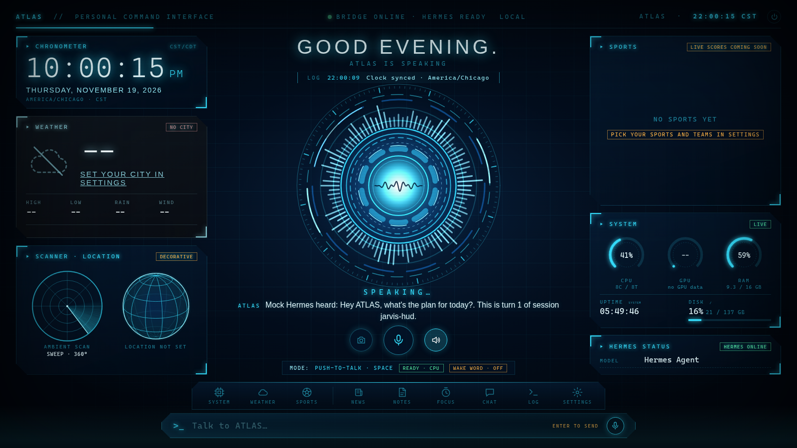

> ATLAS is an independent community project. It is not made by or affiliated with Nous Research; "Hermes Agent" belongs to its authors.

## Download

Get the installer for your system from the **[latest release](https://github.com/amertafech-png/atlas/releases/latest)**:

| System | File | Direct link |
|---|---|---|
| Windows 10 / 11 | `ATLAS-Setup.bat` | [download](https://github.com/amertafech-png/atlas/releases/latest/download/ATLAS-Setup.bat) |
| macOS 11+ (Intel & Apple Silicon) | `ATLAS-Setup.command` | [download](https://github.com/amertafech-png/atlas/releases/latest/download/ATLAS-Setup.command) |

### Windows
1. Download `ATLAS-Setup.bat` and double-click it.
2. **SmartScreen warning ("Windows protected your PC")?** The file isn't code-signed. Click **More info -> Run anyway**.
3. A small **setup window** opens (no black console, nothing to type): a **Welcome** screen, an **Options** page, then a live **step list with check marks**, a status line and a progress bar. When you press **Finish**, ATLAS opens straight into its **AI sign-in** (ChatGPT / Claude / Grok / OpenRouter / a local model) and then asks your **name, city and favorite sports**.
   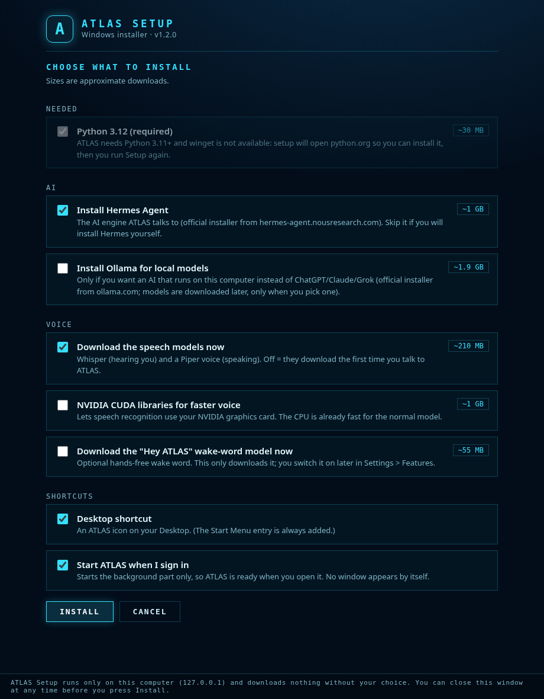

### macOS
1. Download `ATLAS-Setup.command`.
2. **Gatekeeper warning ("can't be opened because it is from an unidentified developer")?** Right-click the file -> **Open** -> **Open**.
   Or in Terminal: `xattr -d com.apple.quarantine ~/Downloads/ATLAS-Setup.command`, then double-click it.
3. The same **setup window** opens in your browser (Welcome, Options, step list with check marks, progress bar); the Terminal window only shows a log and never asks a question. Press **Finish** and ATLAS opens into its AI sign-in, then your name, city and sports. Later you can open ATLAS from `~/Applications` (Launchpad / Spotlight).
   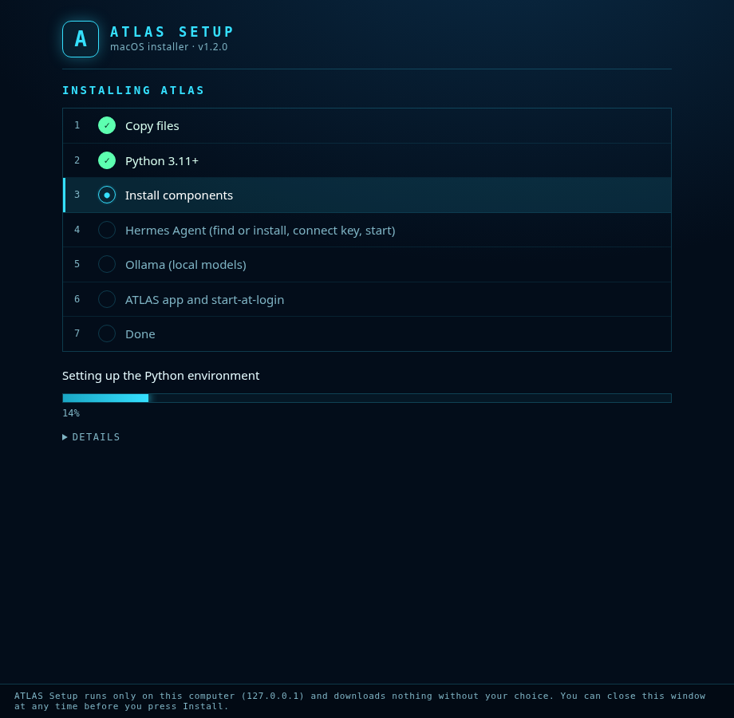
4. If macOS says `ATLAS.app` can't be opened: right-click it -> **Open**, or `xattr -dr com.apple.quarantine ~/Applications/ATLAS.app`.

You can verify a download against the `SHA256SUMS` file attached to the release (`shasum -a 256 ATLAS-Setup.command` /
`certutil -hashfile ATLAS-Setup.bat SHA256`).

## What you need
* **Windows 10/11** or **macOS 11+**, about 2 GB free disk space, and an internet connection for the install.
* **Your own AI account.** ATLAS doesn't include or resell any AI. The installer sets up Hermes Agent, and the first time ATLAS opens it asks which AI **you** use
  (ChatGPT, Claude, Grok, OpenRouter, or a free local model via Ollama) and signs you in through Hermes - no files to edit. You can change it later in Settings -> AI connection.
  Usage is billed by your provider, not by ATLAS.
* A microphone (voice) and optionally a webcam (vision). Microsoft Edge or Google Chrome (Windows) / Chrome, Edge or Brave (macOS) is used for the app window;
  without one ATLAS opens in your default browser.
* Python 3.11+ - the installer checks and offers to install it for you.

## What ATLAS downloads
Only what is missing on your computer. The installer's **Options** page lists each optional item with a one-line reason and its download size, and everything optional starts **off** except what ATLAS needs (CUDA only appears if an NVIDIA GPU is found, and is off). Full details (sizes, sources, locations) are in [docs/INSTALL-NOTES.md](docs/INSTALL-NOTES.md#what-atlas-downloads).

| What | For | When | Size | From | Optional? |
|---|---|---|---|---|---|
| Python 3.11+ | runs ATLAS | install, if not found | ~30 MB | winget / python.org (Windows), Homebrew / python.org (macOS) | no |
| ATLAS's Python packages (aiohttp, psutil, faster-whisper, av, piper-tts, tzdata) | bridge, speech | install | ~500 MB | PyPI | no |
| Hermes Agent (+ its own dependencies) | your AI's brain | install or first run, if not found | ~1 GB | `hermes-agent.nousresearch.com` (Hermes' official installer) | skip if you already have it |
| Whisper `base` speech model | voice input | install or first use | ~150 MB | Hugging Face | needed for voice |
| Piper voice `en_GB-alan-medium` | spoken replies | install or first use | ~60 MB | Hugging Face | yes (macOS can use its own voice) |
| CUDA libraries | GPU speech recognition | install, only if you have an NVIDIA GPU and say yes | ~1 GB | PyPI | yes |
| `vosk` + Vosk model | "Hey ATLAS" wake word | only when you turn it on | ~55 MB | PyPI, `alphacephei.com` | yes, off by default |
| Ollama + a local model | a free local AI | only if you tick **Install Ollama** on the Options page (default off) or later pick a local model | Ollama ~1.9 GB (Windows) / ~230 MB (macOS), models 2-10+ GB | `ollama.com` | yes |
| ATLAS updates | new versions | update check about every 12 h; you click Update | ~1.3 MB | GitHub Releases (checksum-verified) | yes |

ATLAS uses the Edge/Chrome already on your computer for its window (nothing is installed for that). Apart from the downloads above, the weather tile calls `open-meteo.com`, live scores (if you follow teams and leave them on) call ESPN's public scoreboard `site.api.espn.com`, a calendar link calls only the address you gave it, Google Calendar (only when you already signed in through Hermes, or after a one-time Connect Google) calls `www.googleapis.com` and `oauth2.googleapis.com`, and Hermes talks to the AI provider you picked. **Nothing else is sent anywhere.**

## What it does
* **Talk to it:** push-to-talk (Space), local speech recognition (faster-whisper) and a local voice (Piper; macOS `say` as a fallback).
* **Show it things:** the camera panel sends one frame to Hermes only when you press **Look**.
* **Live system tiles**, a chat history shared with your voice conversations, a focus timer and notes.
* **Conversation mode:** after ATLAS speaks an answer (push-to-talk or wake word) it listens again for a few seconds (6 s by default, 3-15 s in Settings) so you can just reply. A countdown ring and a soft tone show the window is open; say "that's all", "stop" or "thanks", press Esc or the mic button, or stay quiet to end it. It starts only after the audio has finished, so it never hears itself.
  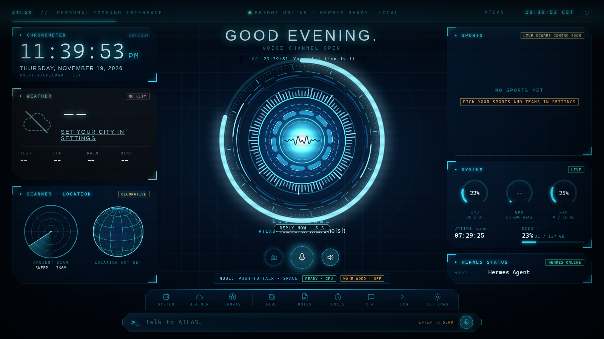
* **Change any setting by voice or chat:** "turn off wake word", "mute", "turn off conversation mode", "change your name to Nova", "set my city to Dallas", "remove soccer", "stop following Juventus", "hide the weather panel", "what are my settings". Risky changes (microphone on, add-ons, switching the AI, reset) ask first. See [GUIDE](docs/GUIDE.md#settings-by-voice-or-chat).
* **Updates itself** (with your click): an *Update* button appears when a new release is published; downloads are checked against a SHA-256 before running.
* **Wake word (optional, off by default):** turn it on in Settings -> Features and just say **"Hey ATLAS"** (or "Hey <the name you gave it>") - fully offline, no account or key. See [GUIDE](docs/GUIDE.md#wake-word).
* **Swappable panels:** choose what each of the six panel slots shows (Settings -> Panel layout, or "replace the scanner with my calendar"). 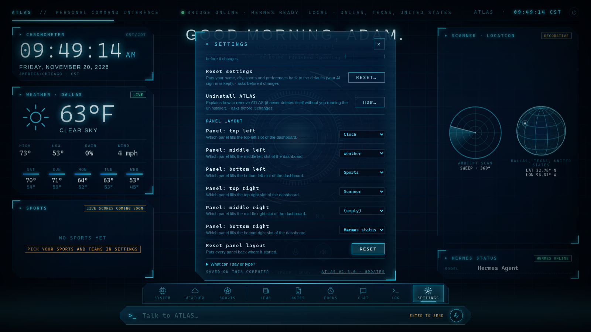
* **Calendar, live scores and a daily brief:** "what's on today" is read from the Google Calendar sign-in Hermes already uses for email (say **connect Google** once if that sign-in doesn't include the calendar). An .ics file or a secret link still works. Live ESPN scores for your teams, and "give me my brief" for weather + calendar + games + reminders. 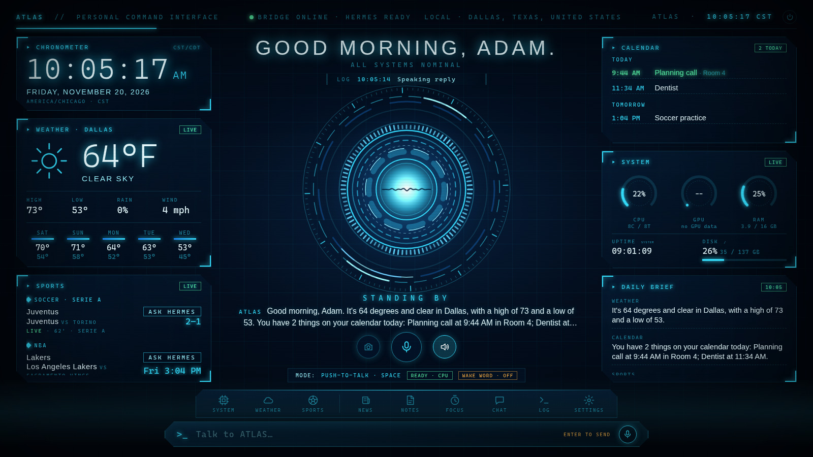
* **Reminders and timers by voice:** "remind me at 3 to call Mike", "set a 10 minute timer", "what reminders do I have", "cancel the timer". Saved across restarts, chime plus spoken alert. 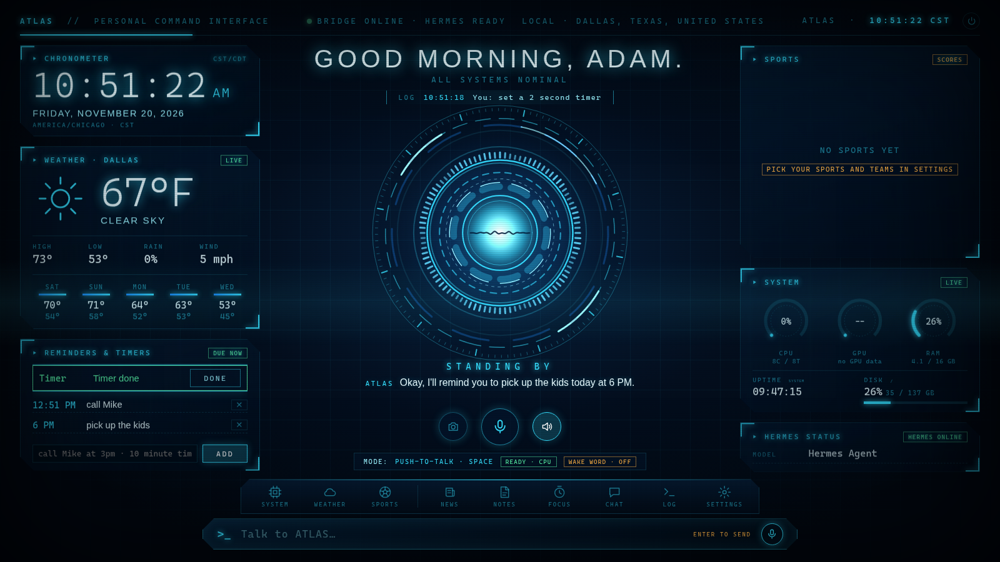
* **Add-on modules with a safety check:** one master switch; a new or changed add-on never runs until you approve it after a plain-words risk notice, a red-flag scan and an AI second opinion. 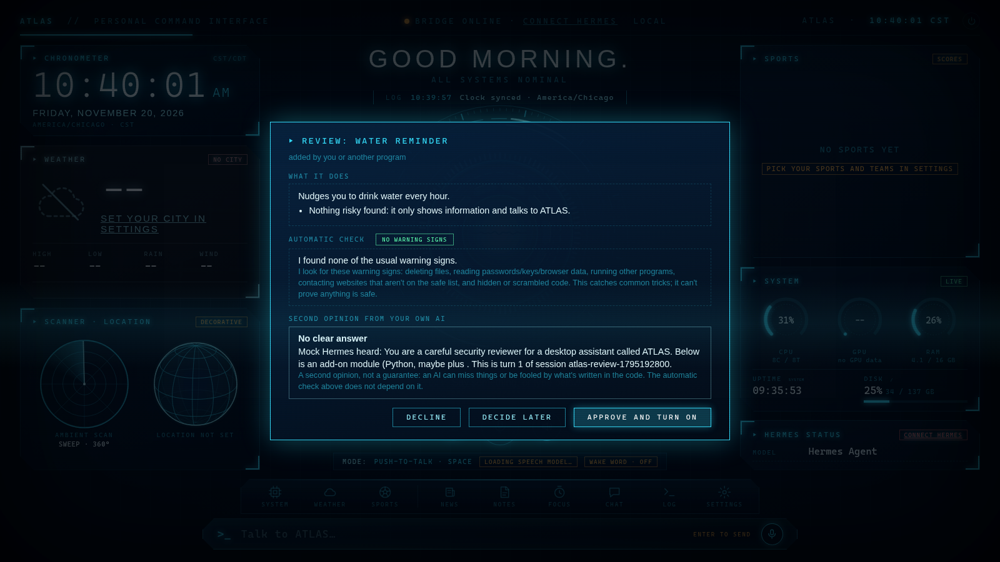
* **Computer control (add-on):** "open Steam", "launch Hades" - opens only what it found installed (Steam, Epic, Start Menu / Applications), asks first by default, cannot run commands. 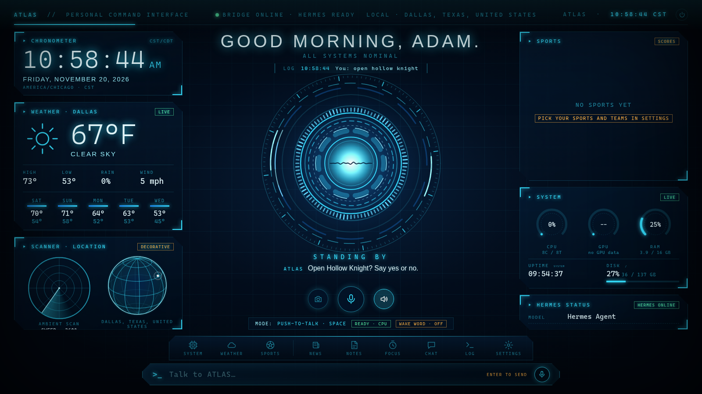
* **Skins and task animations:** cyan, ember, violet or emerald, and a centre that changes for thinking, searching, weather and music. 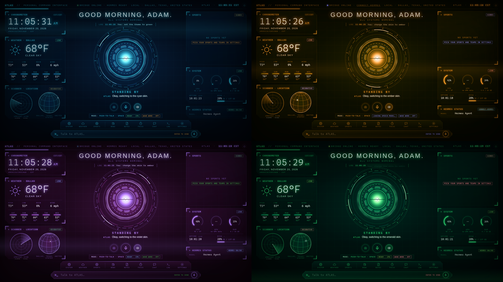
* **Still planned as optional modules:** hand gestures and phone (Telegram) access.

* **Made for you:** name your assistant (it ships as ATLAS; rename it to anything, 1-20 characters), and tell it your name, city, favorite sports and teams (installer or Settings). Weather and the globe follow your city (free Open-Meteo, no key). The Sports panel follows only the sports and teams you leave on (remove any of them in Settings) and refreshes scores on its own from ESPN's public scoreboard (no key): about every 15 seconds while one of your teams is playing, and about every 5 minutes otherwise. It shows the live score during a game, and the latest final or the next game when nothing is live. If ESPN doesn't answer, the last scores stay on screen with a small "stale" mark. ATLAS never invents a score. **Ask Hermes** is still there if you want a sentence about a team.

Known limits today: the wake word needs a reasonably quiet room and works best with distinctive names; the other modules above are not built yet.

## Privacy
* ATLAS runs on your computer. The HUD and bridge listen on `127.0.0.1` only and refuse requests from other websites.
* **No data is sent to the ATLAS author or any ATLAS server. There is no telemetry, no account and no analytics.**
* Your voice is transcribed on your machine. With the wake word on, your microphone stays open while ATLAS's window is open; that audio is analysed on your computer only, never saved or sent anywhere, and you can mute it with one click. Text you say or type goes to **Hermes Agent on your computer**, which sends it to **the AI provider you chose** (same as using Hermes in a terminal).
* Network connections ATLAS itself makes: GitHub (`api.github.com`, to check for updates - disable under Settings -> Updates), Hugging Face (one-time speech model download), alphacephei.com (one-time ~41 MB wake-word model, only if you switch the wake word on),
  open-meteo.com (city lookup and weather for the city you entered), ESPN's public scoreboard (`site.api.espn.com`, only if you follow teams and leave live scores on — the league and the date, no account), and, for your calendar, Google (`www.googleapis.com` to read events, `oauth2.googleapis.com` to refresh the sign-in, and `accounts.google.com` in your browser when you press Connect Google). Webcam frames are only sent when you press Look.
  The Google token stays in the Hermes folder or in ATLAS's data folder. It is never sent to the ATLAS author and never written into the log.
* Conversation history is stored locally in ATLAS's data folder (`%LOCALAPPDATA%\ATLAS` or `~/Library/Application Support/ATLAS`). Uninstalling can delete it.
* Hermes' local API key is generated on your machine during install and is never printed or uploaded.

## License
MIT - free to use, modify and share, including commercially. See [LICENSE](LICENSE). Copyright (c) 2026 Amer Tafech.

## Uninstall
Run the installer again and choose **Uninstall** (or `ATLAS-Setup.bat uninstall` / `ATLAS-Setup.command --uninstall`). Hermes Agent itself is not removed.

## The installer, step by step
No console, no questions typed. Everything below is a click. **When you press Finish, ATLAS opens straight into its AI sign-in (ChatGPT / Claude / Grok / OpenRouter / Local) and then asks your name, city and favorite sports.**

| | |
|---|---|
| 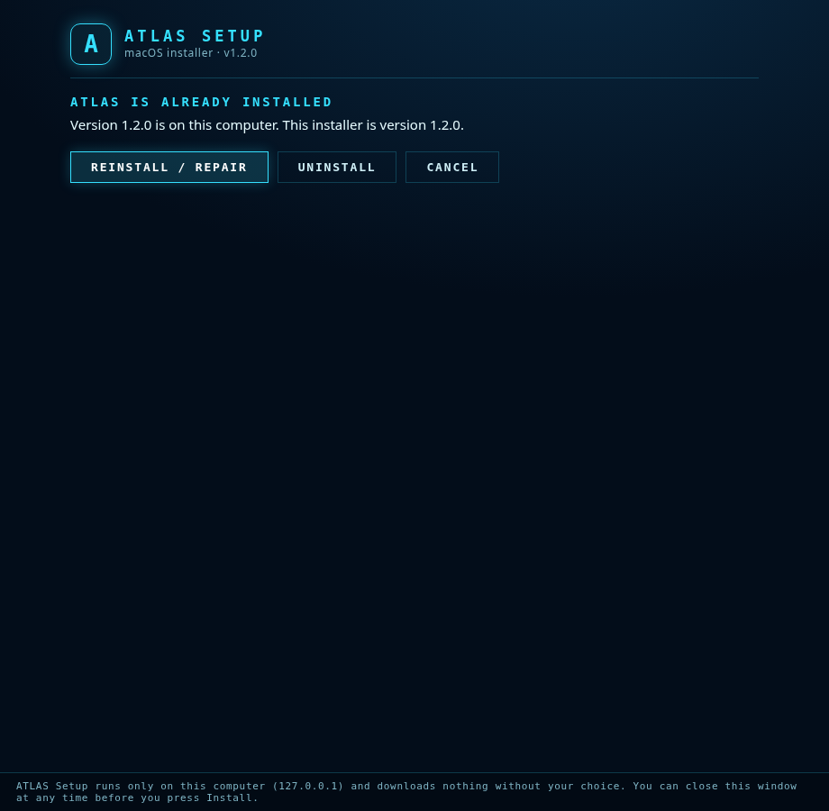 | **1. Welcome.** What is about to happen. |
| 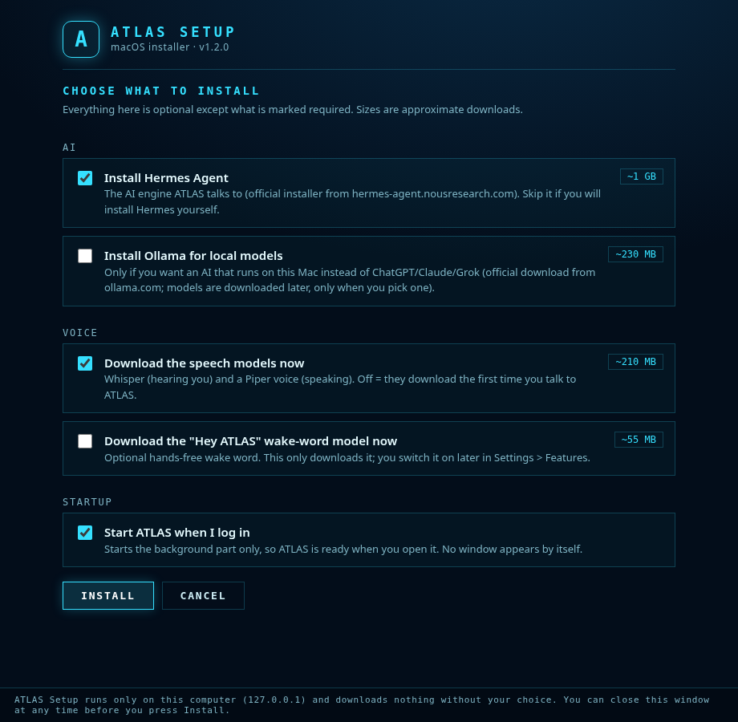 | **2. Options.** One checkbox per optional item, with a one-line reason and its download size. Ollama, the wake-word model and CUDA (only shown with an NVIDIA GPU) start off. |
|  | **3. Installing.** A step list with check marks, a status line and a progress bar. Hermes and Ollama are installed here too. (Windows: `docs/installer-running-windows.png`.) |
| 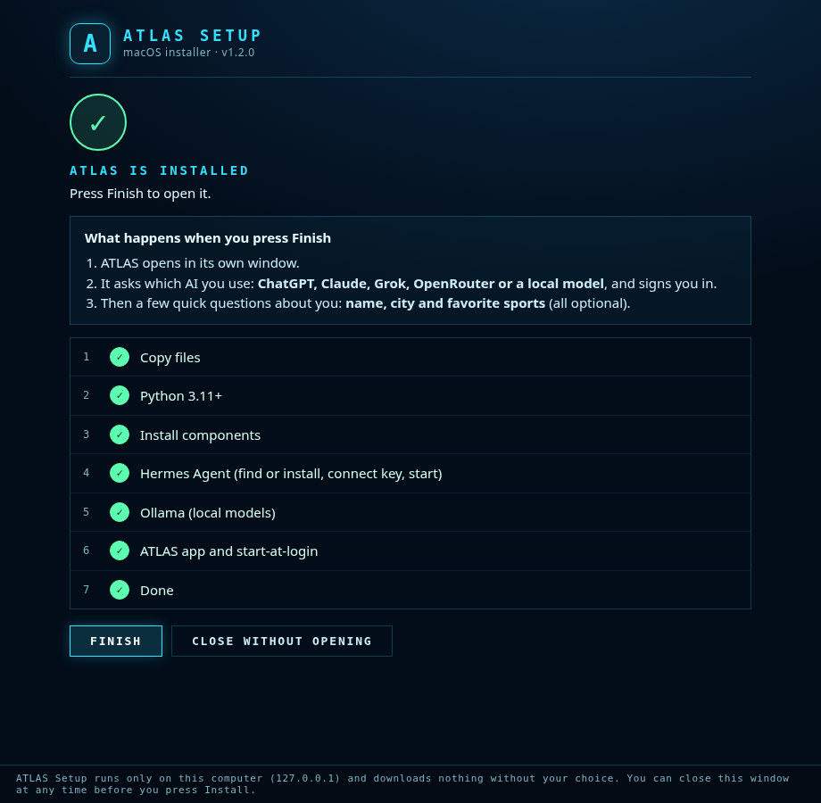 | **4. Done.** **Finish** opens ATLAS into the AI sign-in, then name / city / sports. |
| 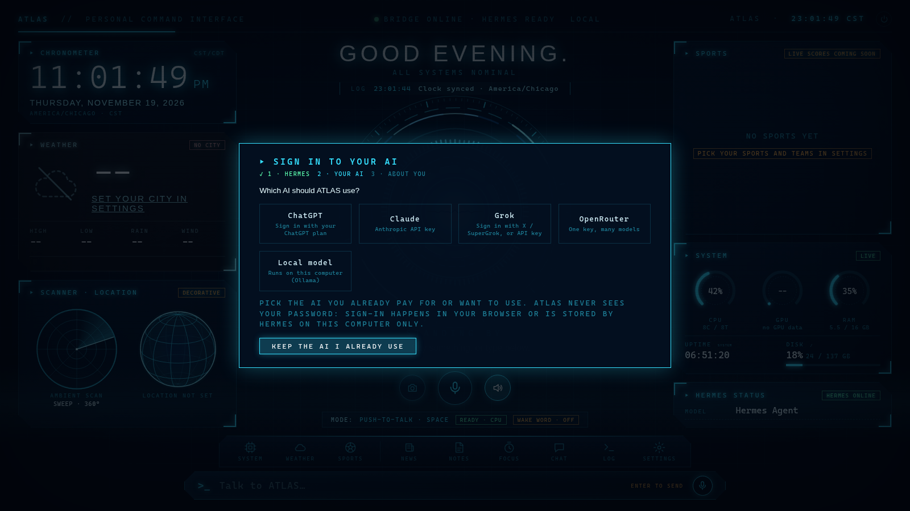 | **ATLAS's first screen:** pick the AI you use (ChatGPT, Claude, Grok, OpenRouter or Local). |
| 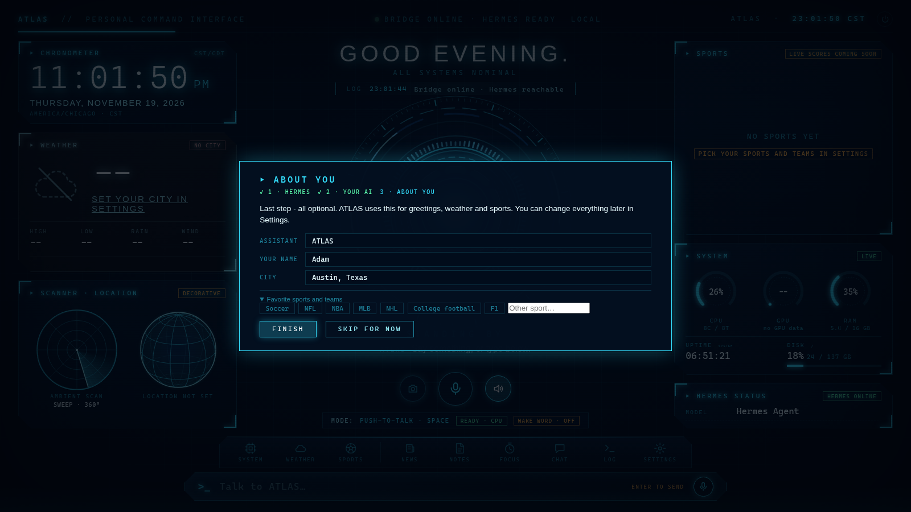 | **Then: name, city, sports** (all optional, changeable in Settings). |
| 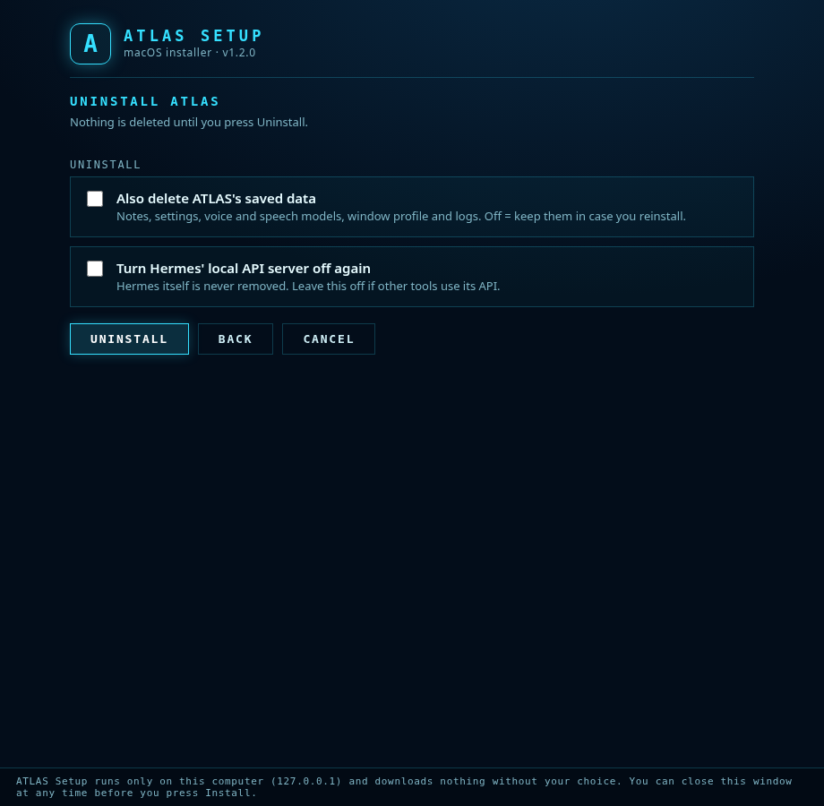 | **Uninstall** uses the same window and asks whether to delete your saved data. |

## More
* [User guide](docs/GUIDE.md) - settings, data folders, troubleshooting, feature modules
* [Contributing](CONTRIBUTING.md) - [Security policy](SECURITY.md) - [Releasing](RELEASING.md) - [License: MIT](LICENSE)
