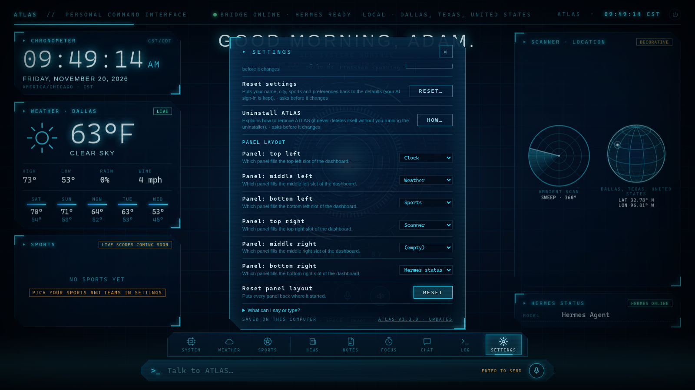
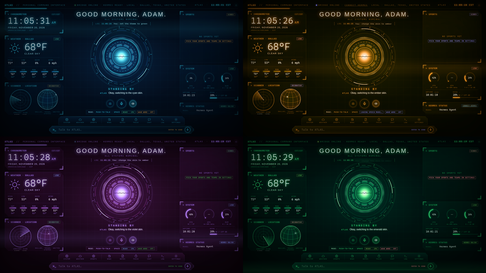
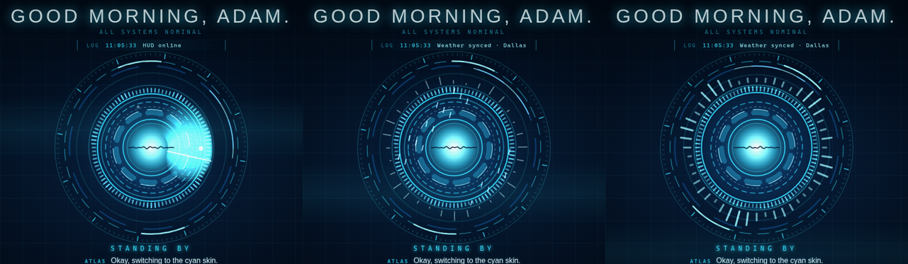
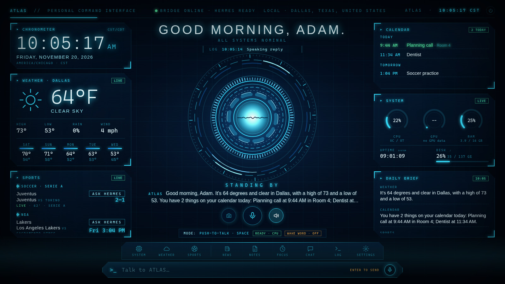
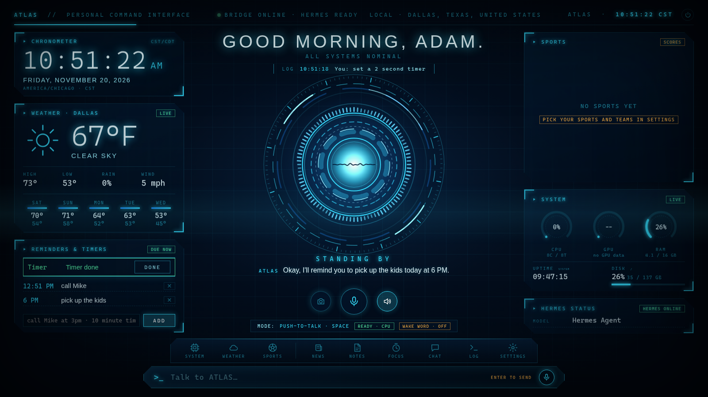
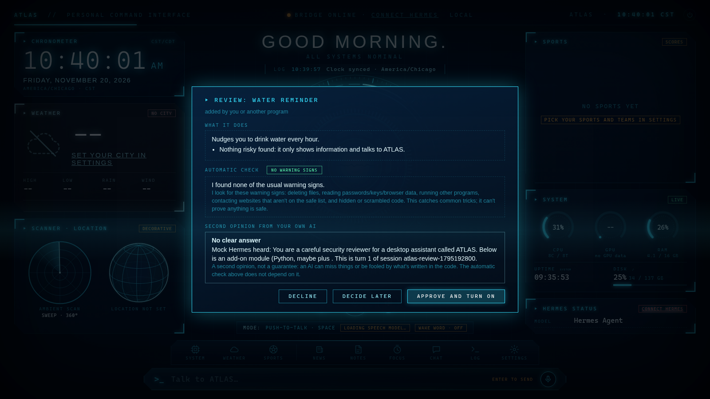
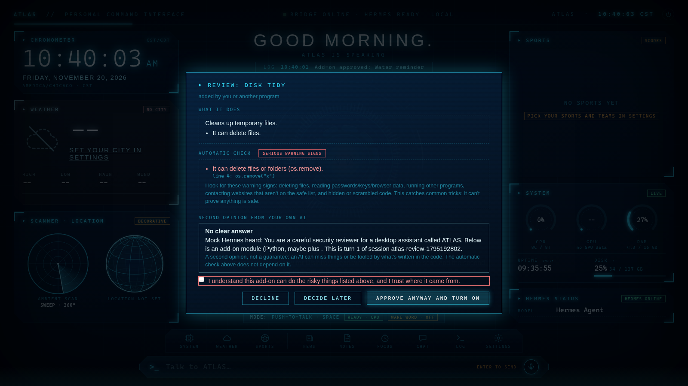
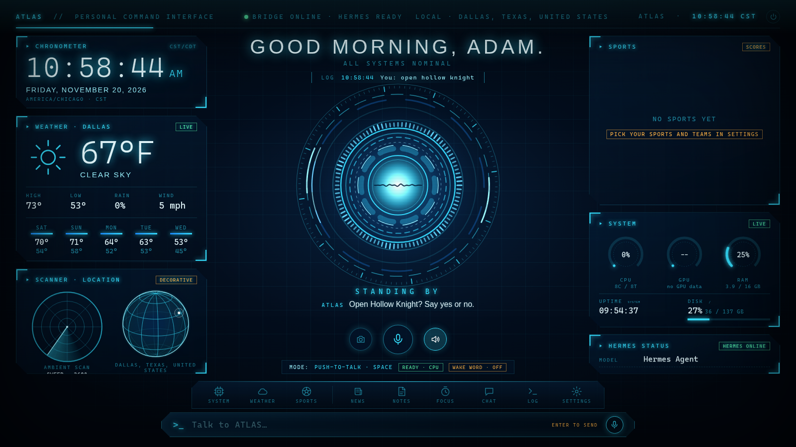

# ATLAS user guide

A full-screen Iron-Man-style interface that talks to **your own Hermes Agent**. It opens as its own
app window (no browser tabs/address bar). Everything stays local: the HUD is served from `127.0.0.1`, speech-to-text
(faster-whisper) and text-to-speech (Piper, or the macOS `say` voice) run on your machine. The only thing that leaves
is whatever Hermes itself sends to its model provider - same as using `hermes` in a terminal.

```
 ATLAS window (Edge/Chrome app mode)  ->  bridge.py (127.0.0.1:8765)  ->  Hermes API server (127.0.0.1:8642)
  mic / camera / orb / tiles             STT + TTS + feature modules      Hermes: tools, memory, vision, fallbacks
```

## Install - one file per OS
| OS | File | How |
|---|---|---|
| **Windows 10/11** | `ATLAS-Setup.bat` | Double-click. SmartScreen: *More info -> Run anyway* (unsigned). |
| **macOS 11+ (Intel or Apple Silicon)** | `ATLAS-Setup.command` | Double-click. Gatekeeper: right-click -> *Open* -> *Open*, or `xattr -d com.apple.quarantine ATLAS-Setup.command`. |

Both installers open a small **setup window** (Windows: an Edge/Chrome app window served by the installer on `127.0.0.1`; macOS: a browser window served by a tiny Perl script) - there are **no console prompts anywhere**:

1. **Welcome** - what is about to happen.
2. **Options** - checkboxes, each with a one-line reason and the approximate download size: Python (if missing, required), **Install Hermes Agent** (~1 GB, on), **Install Ollama for local models** (off; ~1.9 GB Windows, ~230 MB macOS), **Download the speech models now** (~210 MB, on), the **"Hey ATLAS" wake-word model** (~55 MB, off), **CUDA libraries** (~1 GB, shown only when an NVIDIA GPU is found, off), **Desktop shortcut** (on), **Start ATLAS when I sign in** (on).
3. **Running** - a step list with check marks, a status line and a progress bar (Python, ATLAS files, Hermes detect/install, Hermes API key + start, speech models, shortcuts...). Hermes and Ollama are installed from inside this window.
4. **Done** - press **Finish**: ATLAS opens straight into its **AI sign-in** (ChatGPT / Claude / Grok / OpenRouter / Local) and then asks your **name, city and favorite sports** (all skippable).

**Re-running the installer updates ATLAS in place** and reuses your previous choices; a silent update (`ATLAS-Setup.bat /update`, `ATLAS-Setup.command --update`, which is what the in-app **Update** button runs) shows no window and asks nothing. Your settings, notes, models and Hermes config are kept. Run the installer with `uninstall` to remove ATLAS (the window asks whether to delete saved data); Hermes is never touched. The Hermes API key is random and never printed (an existing Hermes key is adopted; the file is backed up first).

### First run: connect your AI
ATLAS checks Hermes by itself and walks you through whatever is missing - no files to edit:
**Install Hermes** (one click, with progress) -> **Fix it** (API key + API server + restart, automatic) -> **Which AI do you use?** ->
a test message -> "Connected to ...". The choices: **ChatGPT** (browser sign-in), **Claude** (API key or Max-plan sign-in), **Grok** (SuperGrok / X Premium sign-in, or an xAI API key),
**OpenRouter** (API key), or a **local model** (Ollama: ATLAS lists your models, can download one, and sets the context size Hermes needs). Sign-ins and keys are stored only
in Hermes' own files (`.env` / `auth.json` in the Hermes folder below), never in ATLAS. Change the AI any time in **Settings -> AI connection**.
If the connection ever breaks, the friendly **Connect Hermes** card appears with a **Fix it** button.

**Local models and tools.** Hermes gives the model a long prompt and a large list of tools. Small local models (**hermes3**, **llama3.2**, anything 1-3B) cannot follow it:
they answer with example tool-call text ("Here is an example of a function call in the format you requested ... Tool: ..."). For a good experience pick a tool-capable model:
**Qwen 2.5 7B**, **Qwen 3 8B** or **Llama 3.1 8B** (or use ChatGPT, Claude or Grok). ATLAS sets a 64k context for the model it connects, marks weak models in the list, retries once when it sees
tool-call text, and then shows a friendly message instead of the garbage. **Settings -> AI connection -> Test my AI** asks a simple question and tells you if the model is too weak.

### What gets installed
| | Windows | macOS |
|---|---|---|
| App files + Python env | `%LOCALAPPDATA%\ATLAS\app` | `~/Library/Application Support/ATLAS/app` |
| Your data (config.json, state, models, logs, window profile) | `%LOCALAPPDATA%\ATLAS` | `~/Library/Application Support/ATLAS` |
| Launcher | Desktop + Start Menu **ATLAS** shortcut (own icon; runs PowerShell directly - no Windows Script Host), *Stop ATLAS* in Start Menu | `~/Applications/ATLAS.app` (own icon) |
| Window | Edge `--app` (falls back to Chrome, then default browser) | Chrome / Edge / Brave / Chromium `--app` (falls back to default browser) |
| Optional login item | Startup-folder shortcut (bridge only) | LaunchAgent `com.atlas.bridge` (bridge only) |
| Hermes data (API key in `.env`, sign-ins in `auth.json`) | `%LOCALAPPDATA%\hermes` | `~/.hermes` |

Starting ATLAS starts the bridge hidden if needed, waits for `/api/health`, then opens the window. Closing the window leaves the bridge
running (fast re-open); the power button in the top bar (or *Stop ATLAS*) stops it. macOS note: the Dock icon while ATLAS is open is the
browser's icon (Chromium app mode limitation); Safari-only Macs get a normal browser tab (Safari: *File -> Add to Dock* for an app-like window).

## Using it
| Action | How |
|---|---|
| **Talk** | Click the orb / mic button, or press **Space**. Stops after ~1.4 s of silence (or Space again). **Esc** cancels. |
| **Reply without pressing again** | **Conversation mode** (below) listens again after each spoken answer. |
| **Hear the answer** | Spoken with Piper (British "alan" by default; macOS falls back to `say` if Piper can't install). Speaker button toggles. |
| **Type** | Bottom bar -> Enter. The **Chat** module shows the whole conversation (voice + typed share one Hermes session). |
| **Show it something** | Camera button -> preview -> optional question -> **Look**. |
| **Settings** | Dock -> **Settings**: switch optional features on/off (see below). |

## Conversation mode
After ATLAS **finishes speaking** an answer to something you said (push-to-talk or the wake word), it listens again - by default for **6 seconds** (3-15 s, **Settings -> Features -> Listening window**; the switch is on by default). A **countdown ring** around the orb and a **soft tone** mark the window; it shows "hearing you" as soon as you start talking, and your reply is handled like any question (and opens another window after its answer).
* It ends quietly if you do not start speaking (nothing is sent, no "I didn't hear anything"), or when you say **"that's all"**, **"stop"**, **"thanks"** (also "thank you", "never mind", "that's it", "no thanks"...), or press **Esc** or the mic button. Typing a message also ends it.
* **It cannot hear itself:** the window opens only after the reply audio has ended (plus a 0.35 s guard), the wake-word listener is held off during the tone, and nothing opens while ATLAS is speaking. Typed questions and muted/text-only replies never open a window.
* Say "turn off conversation mode" or "set the listening window to 10 seconds" - see below. Test: `bridge/dev/test_conversation.py`.

## Settings by voice or chat
Everything in **Settings** can also be changed by saying or typing it. The bridge answers these itself (a local intent handler in `/api/chat`, before anything is sent to Hermes) and the reply is spoken:
* **Wake word / modules:** "turn off wake word", "turn on wake word", "turn on computer control", "turn off the daily brief".
* **Sound:** "mute" / "unmute" (text-only replies), "use the lessac voice", "speak faster", "set the speaking speed to slow".
* **Conversation:** "turn off conversation mode", "set the listening window to 10 seconds".
* **You:** "change your name to Nova", "call me Adam", "set my city to Dallas".
* **Sports:** "follow soccer", "follow Juventus in soccer", "add Serie A to my soccer leagues", "stop following Juventus", "remove soccer", "remove all my sports", "what sports do I follow".
* **AI:** "switch to Claude" (opens the sign-in for it), **Panels:** "hide the weather panel", "show the sports panel". **System:** "turn on start at login", "turn off automatic updates", "check for updates", "install the update", "reset my settings", "uninstall ATLAS".
* **Ask:** "what are my settings", "what is my city set to", "is conversation mode on", "what can I change".

**Risky changes ask first** and wait for "yes" (typed or spoken; "no" or anything else cancels; the question expires after 2 minutes): turning the **wake word** (microphone) or an **add-on** (computer control, hand gestures, Telegram) ON, **switching the AI provider**, **removing a whole sport**, **installing an update**, **reset**, **uninstall**. Turning the wake word OFF is immediate, and ATLAS tells you it can no longer hear "Hey ATLAS" - turn it back on with push-to-talk, chat, or Settings -> Features. "Uninstall" only explains how; it never deletes anything itself.

**One registry** (`bridge/atlas_settings.py`) lists every setting with its id, friendly names, type, allowed values, confirmation rule and example phrases. The Settings screen (`GET /api/settings`; the **General** tab is drawn straight from it), the setter (`POST /api/settings/<id>`, which enforces the same confirmation rule) and the voice/chat handler all use it, and a test checks that every entry is reachable by its example phrases (`bridge/dev/test_settings.py`, `test_settings_ui.py`). Values live in `config.json` (`prefs`, `profile`, `assistant`, `tts`, `features`); the bridge is the source of truth, so the HUD, voice and Settings never disagree.

## Settings - `config.json`
Defaults live in `bridge/config.json`; put your overrides in **`<data dir>/config.json`** (survives updates; same keys, only what you change):
`mode` (`api`/`cli`), `hermes.api_url`/`api_key` (empty = auto-read `API_SERVER_KEY` from Hermes' `.env`), `stt.model|device|language`,
`tts.engine` (`auto`/`piper`/`say`), `tts.voice`, `tts.say_voice`, `tts.say_rate`, `port`. Env overrides: `JARVIS_PORT`, `JARVIS_MODE`,
`HERMES_API_URL`, `HERMES_API_KEY`, `ATLAS_HOME` (data dir).
GPU speech-to-text (Windows/NVIDIA, optional): the installer offers it; or set `"stt": {"device": "cuda"}` after
`pip install nvidia-cublas-cu12 nvidia-cudnn-cu9` in the app's `.venv`. CPU is fast enough for the `base` model.

## Your profile (assistant name, your name, city, sports)
The installer asks (all skippable); change everything any time in the HUD: dock -> **Settings** -> **Profile** -> **Save profile**.
* **Assistant name** - ships as **ATLAS**; rename it (1-20 characters: letters, numbers, spaces, `. ' -`). The new name is used in the window title, headers, greetings, captions, chat and the instructions sent to Hermes ("You are <name>"). It is also stored with a wake phrase (`Hey <name>`) for a future wake-word feature. The app, install folders and shortcuts stay named ATLAS so updates keep working. Leave it empty to go back to ATLAS.
* **Your name** - used in greetings.
* **City** - resolved with Open-Meteo's free geocoder (no key) into latitude, longitude, timezone and units (Fahrenheit/mph in the US, Celsius/km/h elsewhere); type `City, State/Country` to disambiguate, or pick one of the suggestions. With no city the weather tile is greyed out with "Set your city in Settings".
* **Sports** - pick your sports (Soccer, NFL, NBA, MLB, NHL, College football, F1, or type your own under "Other"), then add favorite teams for each (type or pick a suggestion; Soccer and College football can also take leagues/conferences such as Premier League or Serie A).
  **Removing:** every team/league chip has an **X** (saved at once; the Sports tile updates immediately), click a team's name to **edit** it, and a sport can be removed with **X Remove sport** or the X on its chip - which asks "Remove Soccer and its 3 teams?" first. Removing the last sport leaves the Sports tile in its empty state. By voice: "remove soccer", "stop following Juventus".
  The Sports tile groups your teams by sport with an **Ask Hermes** button for the latest result (no live scores feed yet; ATLAS never invents scores).

Stored in `config.json`: `assistant` (`name`, `wake_phrase`) and `profile` (`name`, `city`, `label`, `lat`, `lon`, `timezone`, `country`, `units`, `sports: [{sport, leagues, teams}]`).
The status tile reads your model name from Hermes' `config.yaml`; `hermes.display_primary|display_fallback|display_next_job` override or add rows.

## Updates
ATLAS checks the project's GitHub Releases shortly after it starts and then about every 12 hours (cached; uses GitHub's free,
unauthenticated API and conditional requests so it stays far below rate limits). When a newer version exists an **Update vX** button
appears in the top bar with the release notes. Clicking **Install update** downloads the installer for your OS from the release,
**verifies its SHA-256** (from the release's `SHA256SUMS` file or the release notes - no checksum, no install), runs it silently
(`ATLAS-Setup.bat /update` / `ATLAS-Setup.command --update`: your data, settings and Hermes setup are kept) and restarts ATLAS; the open
window reloads by itself. Offline or no releases yet: it just says "Couldn't check" / "up to date". Turn automatic checks off in
**Settings -> Updates**, or in `config.json`: `"update": {"enabled": false}`. Other keys: `update.check_hours`, `update.repo` (default is
set in `bridge/atlas_meta.py`). 

## Wake word
Off by default. Switch it on in **Settings -> Features -> Wake word** (you are asked to confirm because it opens your microphone). Then say **"Hey ATLAS"** - or **"Hey <name>"** if you renamed the assistant in Settings -> Profile (the phrase follows the name, no training needed). ATLAS plays a short tone, the orb shows the listening animation, and it carries on exactly like the mic button: you speak, it answers out loud.
* **Local and private:** the HUD window opens the mic and streams only short bursts of speech (silence is never sent) to the bridge on `127.0.0.1`, where a small offline speech model ([Vosk](https://alphacephei.com/vosk/), Apache-2.0) turns it into text that is compared with the phrase and thrown away. Nothing is recorded, saved or uploaded. No account, no API key.
* **First use:** a ~41 MB model (`vosk-model-small-en-us-0.15`, SHA-256 verified) is downloaded once into `<data dir>/features/wake_word/` with a progress bar in Settings and in the **Wake** chip under the orb; the `vosk` pip package is installed from the Install button (or by the installer). After that it works offline.
* **Indicator and mute:** the chip under the orb shows **Hey ATLAS** with a pulsing green dot while the microphone is armed (your browser also shows its own recording indicator). Click the chip - or Settings -> Mute - to mute: the microphone is released completely. It pauses by itself while ATLAS is listening, thinking or speaking, so it never answers itself.
* **Accuracy tips:** speak the phrase naturally, then pause for the tone before the command (anything you say before the tone is not heard by the command recording). Names that are real words in the speech model (ATLAS, Nova, Jarvis, Friday ...) work best; made-up names are matched fuzzily. If a name keeps being misheard, add what it sounds like under **Also accept** (e.g. `moody`).
* **Limits:** English only (small model); it needs the ATLAS window open (it lives in the HUD, so ATLAS cannot hear you if the window is closed); a noisy room, a far-away mic or speakers playing loudly lower accuracy; CPU use is near zero in silence and roughly a quarter of one core while someone is talking.
* **Files:** `bridge/modules/wake_word.py` (engine, model download, WebSocket `/api/m/wake_word/ws`, mute/aliases/status endpoints) and `wake_word.js` (microphone capture, speech gate, tone, Settings controls). Tests: `bridge/dev/test_wake.py`.

## Panels, slots and skins
The HUD has **six panel slots**. Each can show any panel: Time, Weather, Scanner, Sports, System, Hermes status, **Calendar**, **Daily brief** or **Reminders**. Panels you are not using wait on a shelf. Change them in **Settings -> Panel layout** (one picker per slot) or by voice: "replace the scanner with my calendar", "put the weather in the top left slot", "hide the system panel", "reset my layout". The layout is saved. 

**Skins:** "change the skin to ember" (cyan - the original, ember, violet, emerald), or **Settings -> Look**. **Task animations:** the centre orb changes with what ATLAS is doing - thinking (orbiting comets), searching (radar sweep), weather (rays and rain), music (equaliser). "Turn off task animations" keeps one steady look.  

## Calendar
Settings -> General -> **Calendars**: add a **file** (full path to an `.ics`) or a **secret link** (Google Calendar -> Settings -> your calendar -> *Secret address in iCal format*; Outlook -> *Publish calendar -> ICS*). No sign-in. Links must be `https://` and must not point at a private network address; the link is masked everywhere ATLAS shows it. Repeating events, all-day events and time zones are handled; the list is refreshed every 10 minutes. Ask "what's on my calendar" or "what's my next meeting". 

## Live sports scores
The Sports panel shows live, final and upcoming games for the teams you follow (Settings -> Profile -> Sports). Scores come from ESPN's public scoreboard (`site.api.espn.com`): the request carries only the league and the date. Turn it off with "turn off live scores". Ask "what's the score", "did Juventus win".

## Daily brief
"Give me my brief" (or the **Daily brief** panel's **Read it to me** button) gives the weather, today's calendar, your teams' games and the reminders still to come. "Turn on the morning brief" makes ATLAS do it by itself the first time you open it each morning.

## Reminders and timers
Say it the way you would to a person:
* "Remind me at 3 to call Mike" / "remind me tomorrow at 9 to send the report" / "remind me in 20 minutes to check the oven" / "at 6 pm remind me to pick up the kids".
* "Set a 10 minute timer" / "timer for an hour and a half" / "set a timer for 90 seconds called pasta".
* "What reminders do I have" / "what timers are running" / "how much time is left on my timer".
* "Cancel the timer" / "cancel the reminder about Mike" / "cancel all reminders" (it asks you to say yes).
If the time is missing ("remind me to call Mike") it asks; "at 9" means the next 9 o'clock. They are saved in `reminders.json` (survive a restart) and appear on the **Reminders** panel with a live countdown and a type-in box. When one is due ATLAS plays a chime and says it (Settings -> Reminder chime turns the chime off; mute silences the voice) - the **Done** button dismisses it. Alerts happen while the ATLAS window is open; one that came due while it was closed is delivered, marked as late, when you open it again. 

## Add-on modules - the safety model
Optional extras live in `bridge/modules/` (shipped) and `<data dir>/modules/` (yours). Because they run with the same access ATLAS has, ATLAS treats them carefully:
* **Master switch** - Settings -> Add-on modules (also "turn off add-on modules"). On by default; turning it off stops every add-on and asks first. Nothing optional runs while it is off.
* **Plain-words risk notice** - shown on first run and whenever a new add-on appears: add-ons can read your files, use your accounts and delete things, so ATLAS never turns a new one on by itself. 
* **Shipped modules** are trusted only while their files still match the SHA-256 list in `bridge/modules/MANIFEST.json` (written by `tools/build.py`; CI fails if it is stale). Anything else - a new drop-in, a shipped file that was edited, a module ATLAS wrote for you - is **pending** and is never imported until approved.
* **Review:** a **red-flag scan** (deleting files, running commands, network access, reading secrets, hidden code...), then an **AI second opinion** from your own AI in a separate Hermes session (the code is passed as untrusted data; the answer is labelled *a second opinion, not a guarantee*). A high-risk scan result needs an extra explicit override. 
* **Approval is tied to the exact file contents.** Change one byte and it needs approving again. **Voice can open the review but can never approve.**
* Modules ATLAS writes for you go through exactly the same steps.

## Computer control (add-on)
Shipped add-on `bridge/modules/computer_control.py` (code in `bridge/atlas_launch.py`). Switch it on in Settings -> Add-on modules (or "turn on computer control"; it asks to confirm).
* "Open Steam", "launch Hades", "play Hollow Knight on Steam", "launch Fortnite on Epic", "open Discord". "What games do I have" and "rescan my games" work too.
* **What it can open:** Steam games (found from `libraryfolders.vdf` and `appmanifest_*.acf`, opened with `steam://rungameid/<id>`), Epic Games (launcher manifests in ProgramData), programs from the Windows Start Menu (`.lnk`), apps in `/Applications`, `~/Applications` and `/System/Applications` on Mac. **Only things from that scan** - there is no way to run a command, a script, a file path or a web address through it, and no shell is used. It cannot close, move, delete or change anything.
* **Names:** forgiving of small slips. If two fit ("star wars") it asks **which one**; if it is only guessing it asks "**Did you mean ...?**".
* **Asks first by default:** "Open Hollow Knight? Say yes or no." Turn that off with "turn off launch confirmation" (Settings -> Add-on modules -> *Ask before opening apps and games*); guesses and ambiguity are always confirmed. 

## Feature modules
`bridge/atlas_features.py` loads optional modules from `bridge/modules/<id>.py` (shipped) and `<data dir>/modules/<id>.py` (drop-ins that survive updates).
Each module gets a `ctx` (settings, private data dir, `say`, `notify`, `ask` Hermes, `confirm` Yes/No dialog, `emit` events to the HUD) and may ship
`<id>.js` to add a dock panel via `ATLAS.register(...)`. Settings toggles are in the HUD; state is saved in `config.json` under `features`.
See `bridge/modules/_example.py`. `wake_word.py` is the reference module with a UI; `computer_control.py` is the reference module with a voice intent (`async def intent(ctx, text)`, optional `has_pending`/`reset`). Other catalogued ids (shown as "coming soon" until a module exists): `gestures`, `telegram`. The daily brief, calendar and reminders are built into ATLAS, not modules. Every module must pass the approval flow above before it is imported. Missing pip packages of an enabled feature are installed from the HUD ("Install") or by re-running the installer.

## Security notes
* The bridge listens on **127.0.0.1 only** and rejects any request whose `Host`/`Origin` isn't `127.0.0.1:<port>` / `localhost:<port>`.
  The Hermes API can run commands, so keep `API_SERVER_HOST` at its default `127.0.0.1`.
* Audio is processed in memory/temp files and deleted at once; webcam frames are sent only when you press **Look**.
  Conversation text is kept in `<data dir>/state.json` (delete to clear).
* Features that act on your computer must ask through `ctx.confirm()` for anything destructive; with no HUD open, confirmations are denied.

## Troubleshooting
| Symptom | Fix |
|---|---|
| Nothing opens / "bridge did not start" | Look at `<data dir>/logs/bridge.log` (and `bridge.err.log` on Windows). Re-run the installer. |
| "Connect Hermes" card / "Hermes unreachable" | Press **Fix it** - ATLAS finds or creates the key, enables the API server and restarts Hermes. Manual check: `curl http://127.0.0.1:8642/health`; `hermes gateway status`. |
| Can't find Settings | Click **SETTINGS** at the right end of the bar along the bottom, press **Ctrl+,** (Cmd+, on a Mac), or say "open settings". While the "Connect Hermes" card is showing, use its **Open Settings** button (or **Not now**). |
| Hermes stopped after closing a PowerShell window | `hermes gateway run` runs Hermes in that window, so closing it stops Hermes. ATLAS now restarts it in the background by itself (it checks every 30 seconds and again when you talk to it). To keep it running yourself, use `hermes gateway install` (starts at sign-in) or `hermes gateway start`. Check it with `hermes gateway status`. Logs: `%USERPROFILE%\.hermes\logs\atlas-gateway.log`. |
| Errors that mention `API_SERVER_ENABLED` or `ClientConnectorError` | Those messages come from an old bridge (MODI / v1.1) <!-- legacy-modi --> that is still running. Close ATLAS, end any `python ... bridge.py` in Task Manager, then open ATLAS again. The launcher now stops a bridge with a different version for you. |
| Links or sign-in pages open in Edge instead of my browser | Fixed in 1.4.1: links go to your default browser (Windows Settings -> Apps -> Default apps). The ATLAS window itself is still an Edge/Chrome app window. |
| Taskbar shows a globe instead of the ATLAS icon (Windows) | Fixed in 1.4.1. Re-run the installer (or update) once so the ATLAS shortcuts get the matching taskbar ID, then open ATLAS from the Start Menu. If an old pinned "globe" button remains, unpin it and pin the new ATLAS window. |
| Edge shows "We are now syncing your browsing data ... signed you in to Microsoft Edge" when ATLAS opens | Fixed in 1.4.2: ATLAS uses Chrome (or your default Chromium browser) when it can, and its own private profile with sign-in and sync off. If it still appears, install Chrome or make it your default browser; ATLAS will use it. |
| A black console window stays open behind the installer | Fixed in 1.4.2 (only a brief flash at the start). Background setup log: `%TEMP%\ATLAS-setup.log`. |
| Clicking the icon does nothing / a "Windows Script Host" window appears | You have an old shortcut (versions before the ATLAS rename used Windows Script Host). Run the new `ATLAS-Setup.bat` once: it repairs the shortcuts. |
| "Hermes rejected the API key" | The key in Hermes' `.env` changed; ATLAS re-reads it by itself, or press **Fix it** on the Connect Hermes card. |
| Mic/camera blocked | Windows: Settings -> Privacy -> Microphone/Camera; macOS: System Settings -> Privacy & Security -> allow your browser (Chrome/Edge). |
| First voice turn slow | Speech models still downloading/loading. |
| Vision says it can't see | Active model must support images, or Hermes needs an `auxiliary.vision` backend (see INSTALL-NOTES.md). |
| `gateway_elevated` (Windows) | Gateway was started as administrator; stop it in an admin window and start it from a normal one. |
| macOS: "ATLAS.app can't be opened" | Right-click -> Open, or `xattr -dr com.apple.quarantine ~/Applications/ATLAS.app`. |

## Folder layout (source)
```
index.html                     the HUD
bridge/bridge.py               local bridge (STT, TTS, Hermes calls, features API)
bridge/atlas_meta.py            version + GitHub repo (one place)   bridge/atlas_update.py   self-updater
bridge/atlas_features.py        feature-module framework      bridge/modules/   feature modules (wake_word.py/.js, _example.py)
bridge/config.json, requirements.txt
win/ATLAS.ps1                     Windows launcher              mac/atlas-launch.sh   macOS launcher
assets/atlas.ico|png|icns       icons                         tools/make_icons.py, tools/build.py  (build the installers)
bridge/dev/                    test tools only (mock Hermes, test_update.py, test_wake.py, screenshot scripts)
```

## License
MIT (see `LICENSE`).
